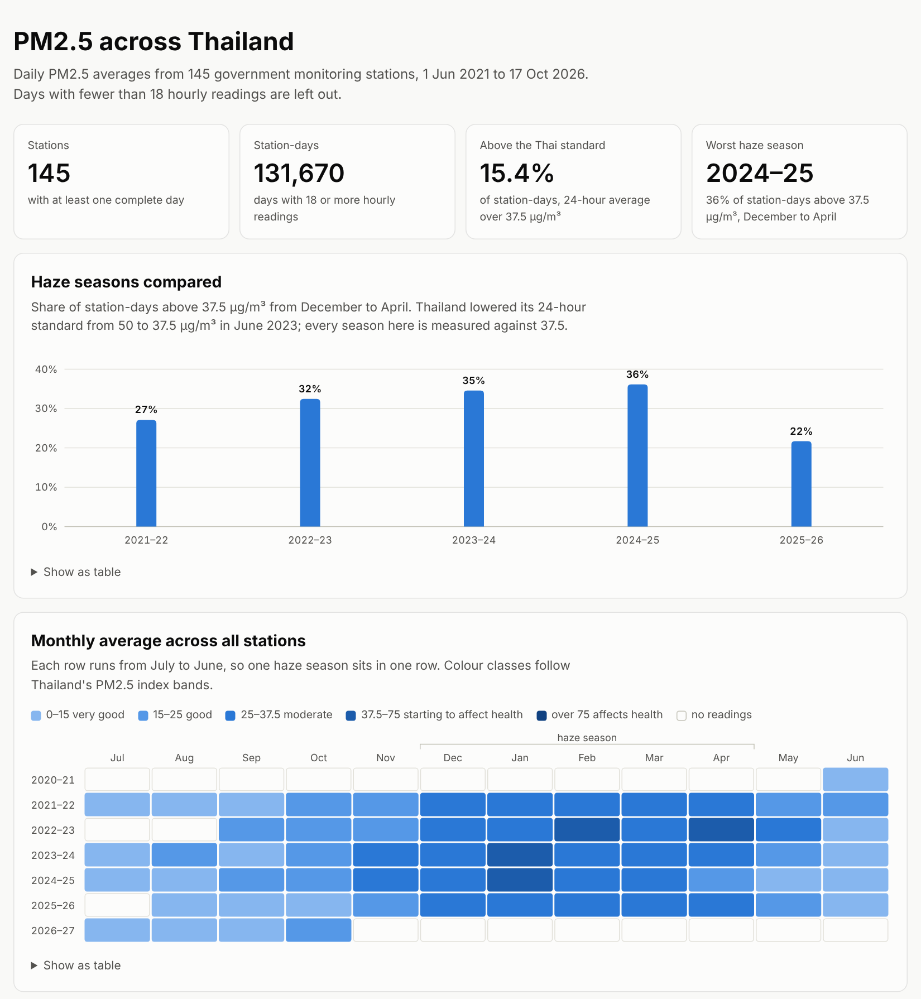
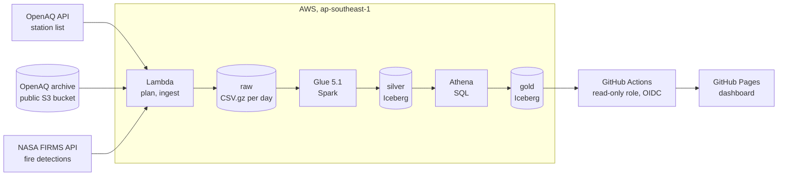
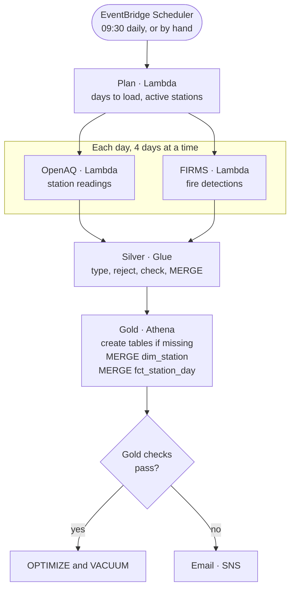

# Thailand air quality lakehouse

[](https://github.com/tongthong-nnk/th-air-quality-lakehouse/actions/workflows/ci.yml)

A daily batch pipeline on AWS that collects hourly PM2.5 readings from Thailand's government air
quality stations and NASA satellite fire detections, stores them as Apache Iceberg tables on S3,
checks the result, and publishes a dashboard that compares the haze seasons since 2021.

Dashboard: https://tongthong-nnk.github.io/th-air-quality-lakehouse/



## What the data shows

Over 131,670 complete station-days at 145 stations, from June 2021 to October 2026:

- 15.4% of station-days were above Thailand's 24-hour standard of 37.5 µg/m³, and 69% were above
  the WHO guideline of 15 µg/m³.
- Nine in ten of the days above the standard fall in the haze season, December to April. 2024–25
  was the worst season, with 36% of station-days above the standard; 2025–26 was the cleanest of
  the five, at 22%. 2022–23 comes out at 32%, but 29 of its 151 days have no complete readings,
  most of them from 24 February to 12 March 2023. In the rest of February 49% of station-days
  were above the standard, so that season was probably worse than it looks.
- January 2025 was the worst month: the average across stations was 47.3 µg/m³, and 68.5% of
  station-days were above the standard.

## How it works



A Step Functions state machine runs the pipeline once a day. The Lambda steps are retried up to
three times. A step that still fails, or a gold check that fails, sends an email through SNS with a
link to the execution.



1. **Plan** picks the days to load and asks the OpenAQ API for the active reference monitors in
   Thailand. A scheduled run loads the days R-7 to R-4, where R is the run date: OpenAQ publishes a
   day about 72 hours after it ends, and the three older days pick up files that arrived late or
   were corrected. A backfill passes `start_date` and `end_date` instead.
2. **Ingest** copies every station's file for one day from the OpenAQ archive into a single
   `raw/openaq/dt=YYYY-MM-DD/part-0000.csv.gz`, and downloads the FIRMS detections around Thailand
   for the same Thai day.
3. **Silver** casts the raw columns, moves rows that fail a rule to `rejected_rows` with the
   reason, runs Glue Data Quality on the batch and merges the readings into Iceberg.
4. **Gold** merges the station list into `dim_station` and rebuilds `fct_station_day` for every
   day whose silver rows changed since the last build.
5. **Checks** query the gold tables for duplicate keys, impossible values, a newest day older than
   six days, and a station count below half of its 30-day median.
6. **Maintenance** compacts the gold tables and removes old snapshots.
7. **Dashboard**: a GitHub Actions workflow exports the gold view to JSON every day and deploys
   the static page in `dashboard/` to GitHub Pages.

## Data model

| Layer  | Table                          | One row per                         | Written by        |
| ------ | ------------------------------ | ----------------------------------- | ----------------- |
| raw    | `raw/openaq/dt=…/`             | file per day, all stations          | Ingest Lambda     |
| raw    | `raw/firms/dt=…/`              | file per Thai day                   | Ingest Lambda     |
| raw    | `aq_silver.locations`          | active station (JSON lines)         | Plan Lambda       |
| silver | `aq_silver.measurements`       | sensor and hour                     | Glue, MERGE       |
| silver | `aq_silver.fire_hotspots`      | fire detection                      | Glue, day replace |
| silver | `aq_silver.rejected_rows`      | rejected input row, with the reason | Glue, day replace |
| gold   | `aq_gold.dim_station`          | station, including ones that closed | Athena, MERGE     |
| gold   | `aq_gold.fct_station_day`      | station and day                     | Athena, MERGE     |
| gold   | `aq_gold.v_station_day` (view) | station and day, with names and flags | Athena          |

`fct_station_day` holds the 24-hour average and maximum, the number of hours with a reading, and
the number of fire detections within 100 km. The view adds `complete_day` (18 hours or more),
`over_thai_std` and `over_who`.

## Design decisions

**Every step can run again.** Ingest overwrites one object per day, and the gzip header carries
no timestamp, so the same input gives the same bytes. Silver merges readings on
`(sensors_id, measured_at)`, with a time range in the join so Iceberg skips the months outside the
batch. FIRMS replaces near-real-time detections with reprocessed ones a few months later, with no
stable row key, so a FIRMS day is always replaced whole. Gold finds its work from a watermark, the
newest silver `ingested_at` it has used, so a daily run, a re-run and a backfill all use the same
statement.

**Checks look at the data, not only the run.** A run can succeed while its data is wrong or has
stopped arriving. Glue Data Quality checks the whole batch before bad rows are split off. A few bad
rows go to `rejected_rows`, but when more than 1% of rows have no sensor or time, or more than 5%
have no value, the source format has probably changed, and the run stops before the merge. After
gold is built, `sql/gold/checks.sql` runs the checks listed above, and the state machine emails
what it found.

**Backfill in yearly runs.** Plan accepts up to 366 days. A Standard Step Functions execution keeps
at most 25,000 history events, and a year of days stays well under it. Ingest runs four days at a
time because a new AWS account can have a Lambda concurrency limit of 10.

**The same code runs without AWS.** The Spark logic lives in `silver.py` and `transforms.py` with
no Glue imports; only `silver_job.py` touches Glue. Locally, Spark writes to an Iceberg REST
catalog in Docker, and Trino, the engine Athena v3 is built on, runs the gold SQL files unchanged.
CI runs the SQL tests on the same Trino.

**Narrow permissions and no stored AWS keys.** Each Lambda function has its own role that can write
only its own `raw/` prefix and read only its own API key. The keys live in SSM Parameter Store and
are created outside Terraform, so they never reach the state file. The FIRMS key is part of the
request URL, so request errors are raised again without it. GitHub Actions gets short-lived
credentials through OIDC, only on `main`, for a role that can query the gold view and nothing else.

**Built for a new account on the Free plan.** No NAT gateway, no customer managed KMS keys, nothing
that runs all the time, and the schedule is off until the first manual run has worked. The checkov
rules this leaves out are listed with reasons in [.checkov.yaml](.checkov.yaml).

**Spark is more than the daily volume needs.** A daily run loads about 15,000 readings, which one
Lambda function with DuckDB could handle. Glue is there for the backfill, 7.5 million readings, and
to keep the Iceberg writes, merges and snapshot expiry in one engine. Flex execution, which runs on
spare capacity, keeps a daily run at about two cents.

## Things the data needed

- OpenAQ stamps an hourly reading with the end of the hour, so a station's file for one day runs
  from 01:00 to 24:00, and 24:00 is written as 00:00 of the next day. Silver steps back one second
  before taking the date.
- Some archive files use singular column names, `sensor_id` and `unit`.
- A station with two PM2.5 sensors reports each hour twice, so `hours` counts distinct timestamps.
- The archive has holes: no station has readings on 280 of the 1,965 days, in ten stretches. The
  longest runs from 7 June to 22 September 2022 (108 days). The dashboard shows them as gaps and
  counts the days each season has, and the freshness check sends an email once the newest day is
  more than six days old.
- FIRMS gives times in UTC as `HHMM` without leading zeros. Thailand is UTC+7, so one Thai day
  needs two UTC dates from the API.
- Thailand lowered its 24-hour standard from 50 to 37.5 µg/m³ in June 2023. Every season is
  compared against 37.5.
- Silver rejects impossible values, such as negative readings or PM2.5 above 1,000 µg/m³, but keeps
  unusual ones. On 11 August 2026 one station east of Bangkok reported about 916 µg/m³ for ten
  hours while every other station averaged below 25 that day: a stuck sensor, which shows as a
  436 µg/m³ day. Telling a fault from a local fire needs the neighbouring stations, and the gold
  layer does not compare them yet.

## Measured

A full backfill, run locally with `make local-run` on 4 CPU cores:

|                                         |                                                      |
| --------------------------------------- | ---------------------------------------------------- |
| Days                                    | 1,965 (1 June 2021 to 17 October 2026)               |
| Stations                                | 145                                                  |
| Raw OpenAQ files                        | 1,965, 40 MB gzip                                    |
| Silver readings                         | 7,461,472, of which 3.59 million PM2.5; none rejected |
| Silver size                             | 21 MB of Parquet                                     |
| Gold station-days                       | 182,357, of which 131,670 have 18 hours or more      |
| Ingest                                  | 12 min 11 s                                          |
| Silver (6 yearly runs), gold and export | 6 min 6 s                                            |
| Full gold rebuild on Trino              | 3.5 s                                                |

This run had no FIRMS key, so it has no fire detections. Silver also keeps PM10, ozone, NO₂, SO₂
and CO, which the gold layer does not use yet.

## Cost

Estimated from list prices in ap-southeast-1:

| Service                                 | Daily run                                     | Backfill            |
| --------------------------------------- | --------------------------------------------- | ------------------- |
| Glue, Flex, 2 × G.1X                    | about $0.02                                   | about $0.20         |
| Step Functions                          | about 35 transitions; 4,000 a month are free  | 6,000 transitions, about $0.05 |
| Athena                                  | under $0.001                                  | under $0.01         |
| S3                                      | under $0.01 a month                           |                     |
| Lambda, SNS, CloudWatch, Scheduler      | free tier                                     | free tier           |

About $0.60 a month with the schedule on.

## Run it locally

Needs Python 3.11 or later, Java 17 for Spark, and Docker for Trino.

```bash
make install
make test        # Lambda handlers with moto, Spark transforms and silver loads
make test-sql    # gold SQL on Trino
```

To run the whole pipeline on your machine, get a free OpenAQ API key. A FIRMS key is optional.

```bash
export OPENAQ_API_KEY=...
make local-up
make local-run ARGS="--start 2026-10-01 --end 2026-10-17"
python -m http.server -d dashboard 8000
```

## Deploy

Terraform in `infra/` creates everything. [docs/deploy.md](docs/deploy.md) goes from storing the
API keys to the backfill and the daily schedule, and how to remove it all.

## Repository layout

```
src/ingest/   Lambda functions: plan.py, openaq.py, firms.py
src/glue/     silver_job.py (Glue entry point), silver.py and transforms.py (plain PySpark)
sql/ddl/      tables and the gold view, created by each run if missing
sql/gold/     gold MERGE statements and the checks
infra/        Terraform, with tests in infra/tests/
scripts/      local runner, Trino helper, dashboard export
dashboard/    the page, in plain HTML, CSS and JavaScript, and its data
tests/        pytest
```

CI runs ruff, pytest on Python 3.11 (Glue) and 3.13 (Lambda), the SQL tests on Trino,
`terraform validate` and `terraform test` with mocked providers, tflint, checkov and actionlint.

## Data sources

- PM2.5 readings from Thailand's Pollution Control Department, through [OpenAQ](https://openaq.org)
  (CC BY 4.0).
- Fire detections from VIIRS on NOAA-20, through
  [NASA FIRMS](https://firms.modaps.eosdis.nasa.gov). We acknowledge the use of data from LANCE
  FIRMS operated by NASA's Earth Science Data and Information System (ESDIS) with funding provided
  by NASA Headquarters.
- Borders from [Natural Earth](https://www.naturalearthdata.com) (public domain).

The code is under the MIT License.
